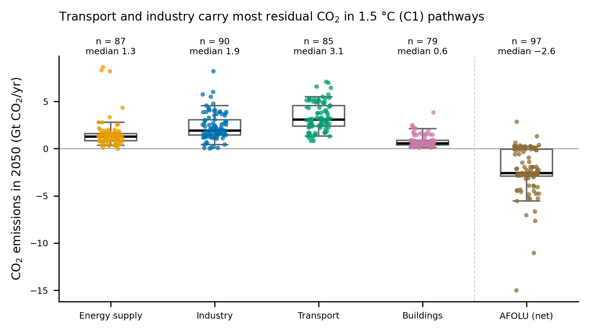
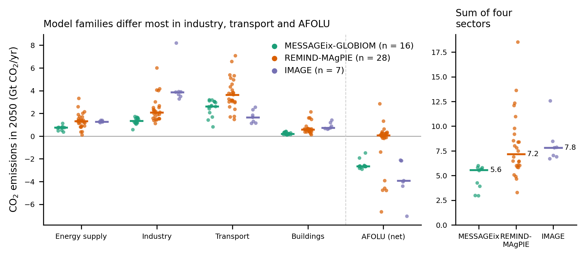
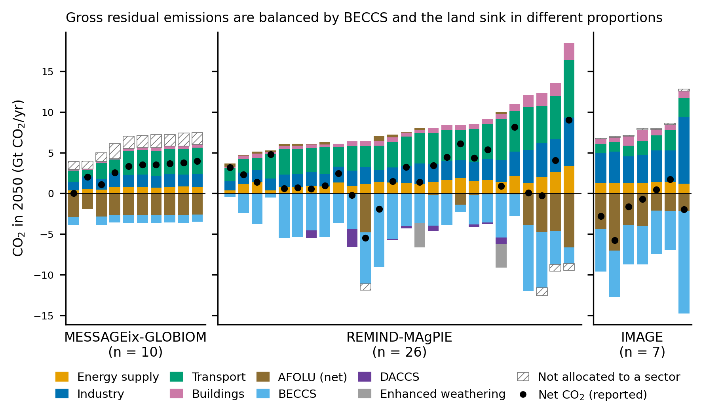

# Residual CO2 emissions by sector in 1.5 °C pathways (AR6 C1)

## Question
How large are residual gross CO2 emissions by sector in 2050 in 1.5 °C pathways
(AR6 category C1, no or limited overshoot), and how much do they differ across
model families?

## Data
AR6 Scenarios Database hosted by IIASA, v1.1 (Byers et al. 2022,
doi:10.5281/zenodo.5886911): World snapshot and metadata indicators. Licence: AR6
Scenarios Database licence, which permits use for scientific research but
restricts redistribution of substantial parts of the data. Raw and extracted data
are therefore not included; see `data/raw/README.md` for how to obtain them.
`results/` holds only summary statistics and the list of inconsistent scenarios.

## How to run
```
conda env create -f environment.yml
conda activate ar6-residuals
jupyter nbconvert --to notebook --execute --inplace notebooks/residual_emissions_C1.ipynb
```
The notebook runs top to bottom in about a minute and writes `figures/`,
`results/` and `data/processed/`.

| path | content |
|---|---|
| `notebooks/residual_emissions_C1.ipynb` | full analysis with explanations |
| `src/ar6_residuals.py` | variable definitions, loading, gross-emission rules, consistency check |
| `src/plots.py` | the three figures |
| `docs/01_iamc_format_and_pyam.md` | short guide to the IAMC format and the pyam operations used |

## Method
1. **Selection.** World region, year 2050, AR6 climate category C1 (97 scenarios).
   Model family = model name without version.
2. **Consistency check.** Four aggregation rules (total CO2; energy and industrial
   processes; energy demand; BECCS) are tested with `pyam.check_aggregate`
   (tolerance 10 Mt CO2/yr + 1 %). Scenarios lacking a required component are
   counted as incomplete, not inconsistent. Failures are listed in
   `results/consistency_failures_C1_2050.csv`.
3. **Gross sectoral emissions.** AR6 sectoral CO2 variables are net of CCS in the
   sector, so gross emissions = net emissions + BECCS captured in that sector
   (energy supply, industry). Fossil CCS is not added back. AFOLU is reported as
   the net flux, because most models do not separate gross land-use emissions
   from land-based removals.
4. **CDR.** BECCS (`Carbon Sequestration|CCS|Biomass`, or the sum of its sectoral
   components where larger), DACCS, land-based removal
   (`Carbon Sequestration|Land Use`) and enhanced weathering, as reported.
5. **Comparison.** Medians and inter-quartile ranges for all C1 scenarios and for
   MESSAGEix-GLOBIOM (16 scenarios), REMIND-MAgPIE (28) and IMAGE (7), the three
   best-represented families.

## Results
Median values for 2050 in Gt CO2/yr (`results/summary_C1_2050.csv`):

| | All C1 | MESSAGEix-GLOBIOM | REMIND-MAgPIE | IMAGE |
|---|---|---|---|---|
| Energy supply (gross) | 1.3 | 0.8 | 1.3 | 1.3 |
| Industry (gross) | 1.9 | 1.4 | 2.1 | 3.9 |
| Transport | 3.1 | 2.6 | 3.6 | 1.7 |
| Buildings | 0.6 | 0.2 | 0.6 | 0.7 |
| Sum of four sectors | 7.3 | 5.6 | 7.2 | 7.8 |
| AFOLU (net) | −2.6 | −2.7 | 0.1 | −3.9 |
| BECCS | 4.2 | 1.0 | 4.1 | 5.2 |

* Across C1 scenarios the energy and industry sectors still emit a median of
  7.3 Gt CO2/yr in 2050 (inter-quartile range 5.8–9.2, n = 68). Transport and
  industry make up about three quarters of this.
* Model families differ more in the composition of residual emissions than in
  their total. IMAGE has about three times the industrial residual of
  MESSAGEix-GLOBIOM; REMIND-MAgPIE about twice the transport residual of IMAGE.
  About 1.5 Gt of MESSAGEix-GLOBIOM demand-side emissions are not allocated to a
  sector, which lowers its sectoral sum.
* Families balance residual emissions differently: REMIND-MAgPIE mainly with
  BECCS, MESSAGEix-GLOBIOM mainly with the land sink, IMAGE with both. DACCS is
  small in 2050 (median 0.1 Gt, reported by 38 scenarios).







## Limitations
* One year (2050) and one region (World).
* AFOLU is a net flux, so residual land-use emissions are not quantified.
* Gross values depend on reporting conventions that differ between models: where
  the sectoral split of BECCS is missing (28 scenarios), all BECCS is attributed
  to energy supply; DACCS appears in different aggregates in different models.
* Model-native values are used, not values harmonised to historical emissions.
* AR6 is an ensemble of opportunity: family sizes differ, and all IMAGE scenarios
  come from a single study. Statistics describe the ensemble, not a probability
  distribution.

## Use of AI assistance
Parts of the code and documentation were drafted with the assistance of an AI
model (Claude, Anthropic) and reviewed, run and checked by the author.
